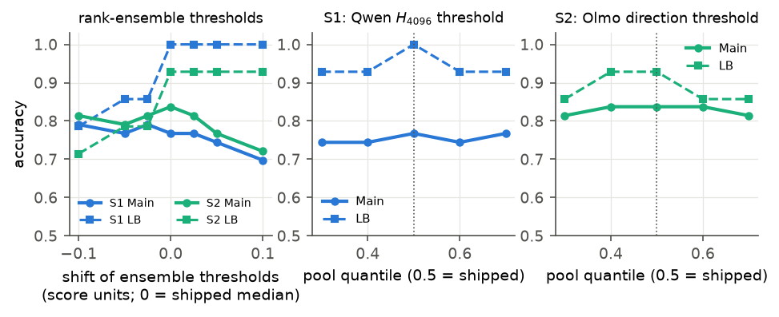
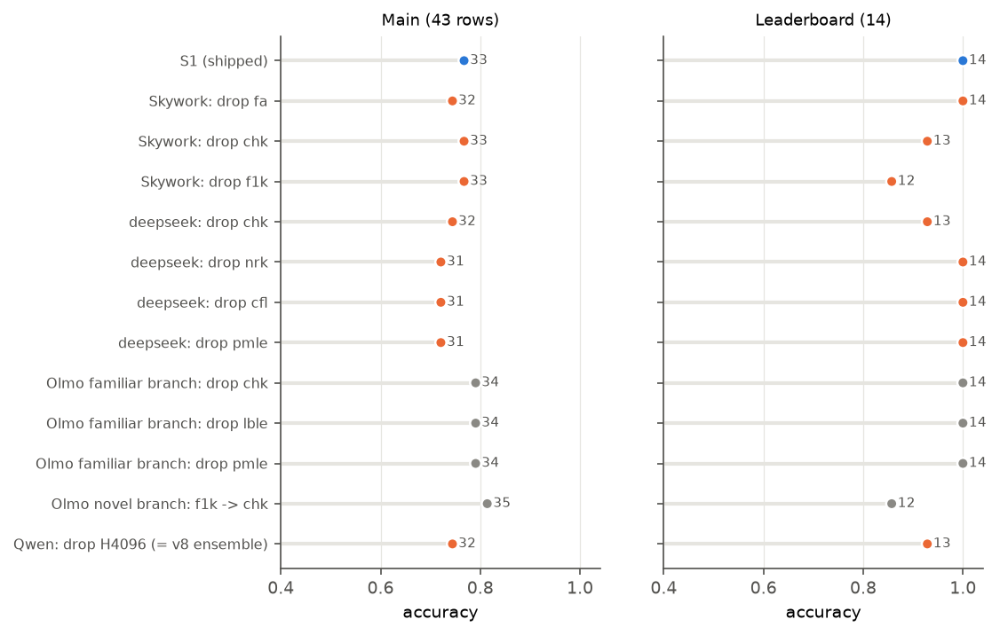
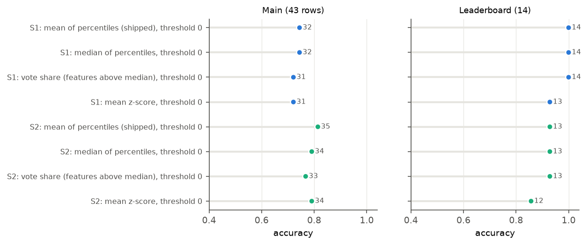
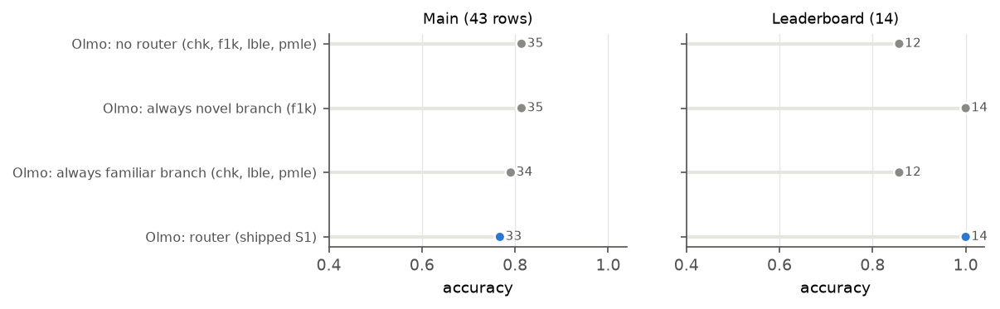
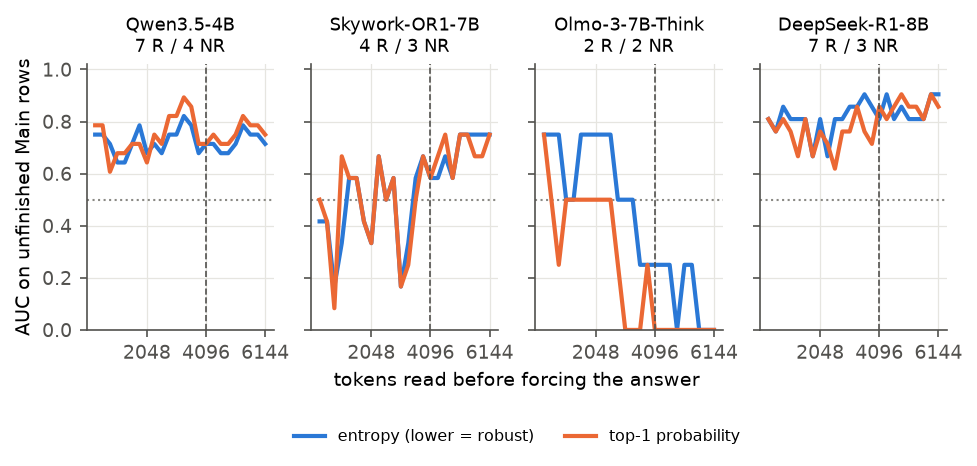

# Appendix ablations (for review)

These run on the **current** submissions:
- S1 = `v8-ent4096`
- S2 = `v8-ent4096-olmoseg25`

Each ablation is scored on `train-main-v2` (Main, 43 rows) and the leaderboard (LB, 14 problems, replayed from logged features). Script:
`analysis/report_appendix_ablations.py`; numbers in `analysis/report_appendix_ablations.csv`. Baselines: S1 = 33/43 and 14/14, S2 = 36/43 and
13/14, all-robust = 31/43 and 7/14. None of these was run on our own labels.

Not re-run: **nested cross-validation** (exp99/101). Its folds score on our own labels, which the report says not to use for measuring
accuracy, and main-v2 has no fitted parameters to cross-validate (thresholds are label-free). The exp101 numbers for v8 exist if you want
them quoted with that caveat.

---

## A. Threshold sensitivity
`appendix_A_threshold_sensitivity.png`

- **Left:** every rank-ensemble threshold (per model, and both Olmo router branches) shifted by d score units. 0 is the shipped
  label-free median, and a score unit of 0.1 is about a 10-percentile shift.
- **Middle / right:** the Qwen $H_{4096}$ threshold and S2's Olmo direction threshold set to other quantiles (0.3–0.7) of their unlabelled pools
  (shipped: 0.5).

| Change | S1 Main / LB | S2 Main / LB |
|---|---|---|
| ensemble d = −0.10 / −0.05 / −0.025 | 34 / 11, 33 / 12, 34 / 12 | 35 / 10, 34 / 11, 35 / 11 |
| **ensemble d = 0 (shipped)** | **33 / 14** | **36 / 13** |
| ensemble d = +0.025 / +0.05 / +0.10 | 33 / 14, 32 / 14, 30 / 14 | 35 / 13, 33 / 13, 31 / 13 |
| Qwen $H_{4096}$ at pool q0.3 / 0.4 / 0.6 / 0.7 (S1) | 32 / 13, 32 / 13, 32 / 13, 33 / 13 | — |
| Olmo direction at pool q0.3 / 0.4 / 0.6 / 0.7 (S2) | — | 35 / 12, 36 / 13, 36 / 12, 35 / 12 |

**Reading:**
- The median is at or next to the best point in every panel.
- Lowering the ensemble thresholds (calling more problems robust) costs 1–3 leaderboard problems. Raising them costs main-v2 rows.
- The single-feature thresholds are flat within ±1 problem.
- No threshold was tuned on these sets, so this is a robustness check, not a selection.

## B. Drop one feature (S1)
`appendix_B_drop_one_feature.png`

Each feature removed from its model's recipe in turn, shipped thresholds kept. Orange = worse than S1 on the two sets combined; grey = not worse.

| Model | Feature dropped | Main / LB (S1: 33 / 14) |
|---|---|---|
| Skywork | `fa` / `chk` / `f1k` | 32 / 14, 33 / 13, 33 / 12 |
| DeepSeek | `chk` / `nrk` / `cfl` / `pmle` | 32 / 13, 31 / 14, 31 / 14, 31 / 14 |
| Olmo (familiar branch) | `chk` / `lble` / `pmle` | 34 / 14 each |
| Olmo (novel branch) | `f1k` → `chk` | 35 / 12 |
| Qwen | $H_{4096}$ (back to the v8 ensemble) | 32 / 13 |

**Reading:**
- Every Skywork and DeepSeek feature carries some weight: dropping any one costs 1–2 calls.
- DeepSeek's `pmle` (prompt attention, the one internal feature in DeepSeek's recipe) is worth 2 main-v2 rows.
- Dropping any one feature from Olmo's familiar branch *gains* a main-v2 row (34). Olmo's main-v2 rows are 4 unfinished problems, so that is one row.
- Swapping Olmo's novel-branch `f1k` for `chk` gains on main-v2 but loses 2 leaderboard problems.

## C. Combiner (how per-feature percentiles become one score)
`appendix_C_combiners.png`

All at threshold 0, the label-free expected median, so the combiners are compared on equal terms.

| Combiner | S1 Main / LB | S2 Main / LB |
|---|---|---|
| **mean of signed percentiles (shipped)** | **32 / 14** | **35 / 13** |
| median of signed percentiles | 32 / 14 | 34 / 13 |
| vote share (features above their median) | 31 / 14 | 33 / 13 |
| mean z-score against the reference values | 31 / 13 | 34 / 12 |

**Reading:** the shipped mean of percentiles is best or tied on both sets. The z-score combiner, which is sensitive to scale and outliers, is
worst on the leaderboard. This agrees with exp67/68 on our own labels.

## D. Olmo routing (S1)
`appendix_D_olmo_routing.png`

| Olmo variant | Main / LB |
|---|---|
| **router (shipped S1)** | **33 / 14** |
| no router: one list (`chk`, `f1k`, `lble`, `pmle`), branch signs | 35 / 12 |
| always the familiar branch (`chk`, `lble`, `pmle`) | 34 / 12 |
| always the novel branch (`f1k`) | **35 / 14** |

**Reading:** neither branch really discriminates. The novel branch (`f1k`) calls almost every problem non-robust, and the familiar branch
(`chk`, `lble`, `pmle`) almost every problem robust. So the router's call is effectively "unfamiliar (low Min-K%) → non-robust":
- **Leaderboard:** right on all 3 unfinished Olmo problems (two unfamiliar non-robust, one familiar robust).
- **Main-v2:** wrong on all 4 (the two non-robust rows are the familiar ones). This is the same Min-K% reversal as exp114.

"Always novel" only looks better on main-v2 (35) because it calls everything non-robust and main-v2's 4 unfinished Olmo rows are 2 / 2.
The one-list variant without the router ties it on main-v2 but loses 2 leaderboard problems.

This doesn't change the shipped submissions; S2 overrides these Olmo calls anyway. It is now one sentence in the report's Limitations. The
judge can't be replayed here: on the leaderboard it matches the router, and on main-v2 only 2 of 4 rows can be replayed, also matching.

*Corrected 2026-11-04:* the no-router row used the global sign of `f1k` (−1) instead of the branches' sign (+1); fixed, 34 → 35 on main-v2.

## E. Truncation curves per model
`appendix_E_truncation_curves.png`

AUC (robust = positive) of the forced-answer entropy (lower = robust) and the top-1 probability, every 256 tokens, on each model's unfinished
main-v2 rows. Dotted line = chance; dashed = 4096.

| Model (R / NR) | Entropy AUC at 1024 / 2048 / 3072 / 4096 / 5120 / 6144 |
|---|---|
| Qwen (7 / 4) | 0.64 / 0.68 / 0.75 / 0.71 / 0.71 / 0.71 |
| Skywork (4 / 3) | 0.33 / 0.33 / 0.17 / 0.58 / 0.75 / 0.75 |
| Olmo (2 / 2) | 0.50 / 0.75 / 0.50 / 0.25 / 0.25 / 0.00 |
| DeepSeek (7 / 3) | 0.81 / 0.81 / 0.86 / 0.81 / 0.81 / 0.90 |

**Reading:**
- For Qwen the signal is stable from about 2k tokens on, which supports reading it at 4096 without the exact budget mattering.
- Skywork becomes informative only late, from about 4.5k tokens.
- DeepSeek is informative throughout, so a forced-entropy readout could help DeepSeek. We didn't use it.
- Olmo has 4 rows and inverts late, consistent with Olmo's forced-answer features failing to transfer (report Section 5).
- With 7–11 rows per model, each curve point is noisy; treat the curves as qualitative.

---

## Suggested use in the report
- Appendix D: A (one figure), C (one small table), D (one small table): about one page. The text can cite them in one sentence each from
  Sections 3.4 and 5.
- B is the most direct "which white-box feature matters" evidence (DeepSeek `pmle`, Olmo `lble`/`pmle`). Cite it from Section 5.1.
- E pairs with Table 4 (truncation point) and Fig. 4 in `FIGURES.md`.
- The D finding (always-novel ≥ router) is worth one honest sentence in the Limitations.
