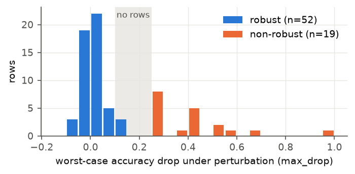
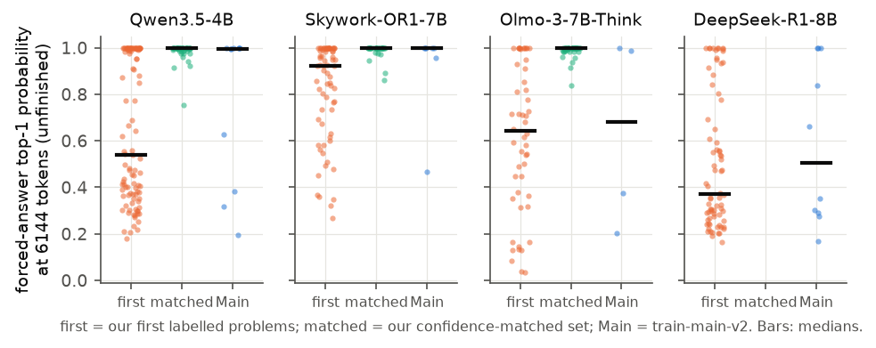
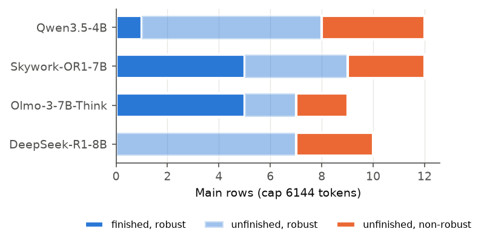
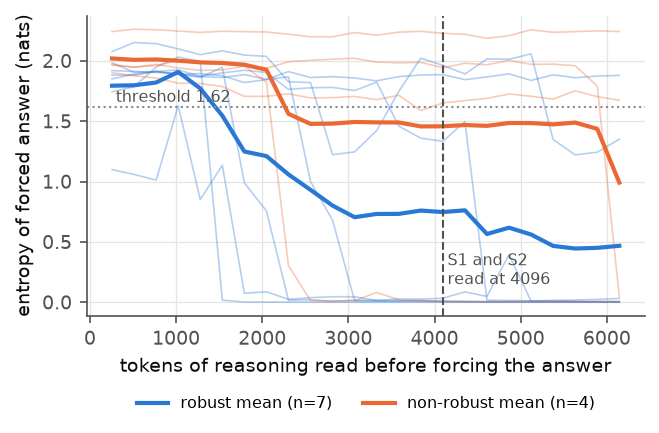
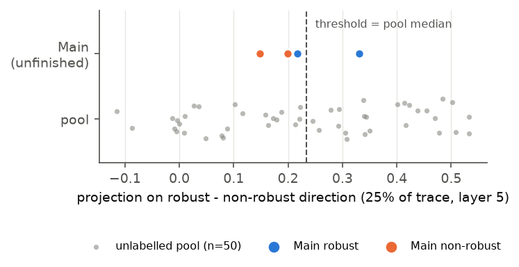
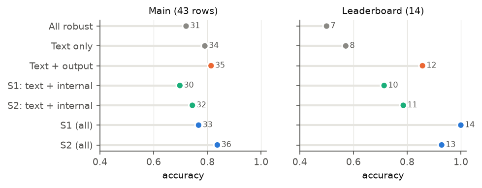
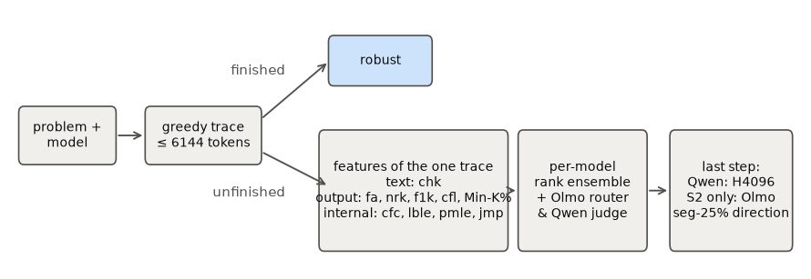

# Candidate figures for the technical report (for manual review)

All figures are drawn on CPU from saved data by `analysis/report_figs.py`; each exists as `.png` (preview) and `.pdf` (for LaTeX, `\includegraphics`).
None is in the report yet. The main text currently ends near the bottom of page 5, so at most one small figure fits there; the rest belong in the appendix, which doesn't count toward the 5 pages.
Colours: blue = robust (or the full submission), orange = non-robust (or the variant without internals), green = our confidence-matched set, grey = baselines / unlabelled. All three hues passed the palette check (colour-blind separation and lightness).

---

## Fig. 1: The official labels have a gap between 0.10 and 0.25
`fig1_maxdrop_by_label.png`

- **What:** histogram of `max_drop` (worst-case accuracy drop under perturbation) for every labelled row of `train-main-v2` (71 rows, all models in the file, not only our four), coloured by the official label.
- **Shows:** robust rows all have a drop of at most 0.10, non-robust rows at least 0.25, and no row lies in between. It's the evidence for the drop rule we inferred (Section 2).
- **Suggested place:** appendix, or a small figure in Section 2.

## Fig. 2: Our first labelled problems were harder than Main
`fig2_confidence_mismatch.png`

- **What:** per model, the forced-answer top-1 probability at 6144 tokens on unfinished greedy traces, for three sets: our first labelled problems, our confidence-matched set, and Main. Dots are traces; black bars are medians.
- **Medians (first / matched / Main):**

  | Model | first | matched | Main |
  |---|---|---|---|
  | Qwen | 0.54 (n=100) | 1.00 (40) | 1.00 (11) |
  | Skywork | 0.92 (69) | 1.00 (30) | 1.00 (7) |
  | Olmo | 0.64 (50) | 1.00 (39) | 0.68 (4) |
  | DeepSeek | 0.37 (74) | — | 0.51 (10) |

- **Shows:** why our first labels track difficulty. For Qwen, and to a lesser degree Skywork, our first problems were much less confidently answered than Main's. For Olmo and DeepSeek, Main itself is low-confidence, but with only 4 and 10 points.
- **Caveat:** the matched set overshoots for Olmo (median 1.00 against Main's 0.68 on 4 rows).
- **Suggested place:** Section 6. This is the best candidate for the one main-text figure.

## Fig. 3: Every non-robust Main row is unfinished at 6144 tokens
`fig3_regime_split_main.png`

- **What:** Main rows per model, split into finished-robust, unfinished-robust and unfinished-non-robust. Finished-non-robust is empty, which the script asserts.
- **Shows:** the regime split costs nothing on Main, and every recipe acts only on the unfinished share: 32/43 rows, 12 of them non-robust.
- **Suggested place:** appendix (supports Section 2's regime-split paragraph).

## Fig. 4: How Qwen's forced-answer entropy evolves over the trace
`fig4_qwen_forced_entropy_curve.png`

- **What:** for each unfinished Qwen trace on Main (7 robust, 4 non-robust), the entropy of the forced answer when the trace is cut every 256 tokens. Thin lines are traces; thick lines are class means. The dashed line marks 4096 (where S1 and S2 read); the dotted line is the shipped threshold, 1.62, the median of 100 unlabelled traces.
- **Shows:** robust traces commit (entropy falls towards 0) from about 1.5–3k tokens. Non-robust traces mostly stay uncertain until late, and drop only near 6144. That's why an intermediate budget separates them and 6144 is weaker.
- **Caveat:** n = 11, and some robust traces stay high-entropy throughout.
- **Suggested place:** Section 5 (next to Table 4) or the appendix.

## Fig. 5: The Olmo direction
`fig5_olmo_seg25_projection.png`

- **What:** projection of the mean layer-5 hidden state at 25% of the trace onto the shipped robust-minus-non-robust direction, for Olmo's 50 unlabelled pool traces (grey) and its 4 unfinished Main rows (coloured). The dashed line is the threshold (pool median, 0.234).
- **Shows:** on Main the ranking is perfect (AUC 1.0), but one robust row sits just below the median threshold, so accuracy is 3/4. Support rests on 4 points, as the report says.
- **Suggested place:** appendix.

## Fig. 6: White-box ablation by feature group
`fig6_whitebox_ablation.png`

- **What:** accuracy of each variant in Table 3: all-robust; text only; text + output (no internals; S1 and S2 coincide there); text + internal (no output) for S1 and S2; and the full S1 and S2. Main and the leaderboard are side-by-side panels with one shared scale, and numbers are correct counts. Colours: grey = baselines, orange = no internals, green = no output, blue = full.
- **Shows:** on the leaderboard neither group alone gets close to the full submissions: output only 0.86, internal only 0.71–0.79, both 1.00 / 0.93. On Main the output-only variant (35) sits between S1 (33) and S2 (36); internal only is at or below all-robust.
- **Suggested place:** Section 5.1 (it could replace Table 3 to save space, or sit in the appendix next to it).

## Fig. 7: Pipeline schematic
`fig7_pipeline.png`

- **What:** problem → greedy trace → finished ⇒ robust / unfinished ⇒ features (grouped into text / output / internal) → per-model rank ensemble with the Olmo router and Qwen judge → Qwen's H4096 readout (both submissions) → S2's Olmo direction.
- **Suggested place:** top of Section 3. It would need about a third of a page; for the camera-ready version a TikZ redraw would look cleaner.

---

## Not generated (need data we don't have locally, or a GPU)
- **Attention block graph** (`jmp`): heatmaps of 64-token-block attention for one robust and one non-robust trace. The per-trace graphs from the white-box run aren't synced locally; regenerating them needs about 1 minute of GPU per trace.
- **Per-feature percentile heatmap** (Main unfinished rows × the 9 v8 features, coloured by percentile, rows grouped by label). CPU-feasible from `feats_mv2`; say if you want it.
- **Lookback / prompt-attention curves over the trace** (`lble`, `pmle`): same as above, needs the per-span arrays, which weren't saved for Main.
