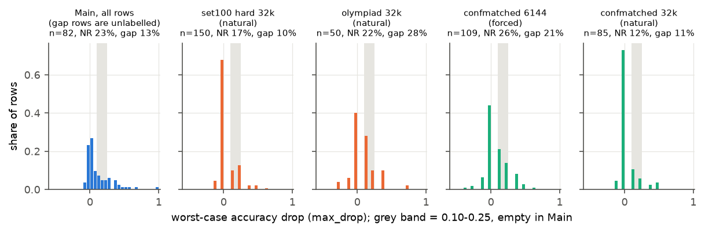
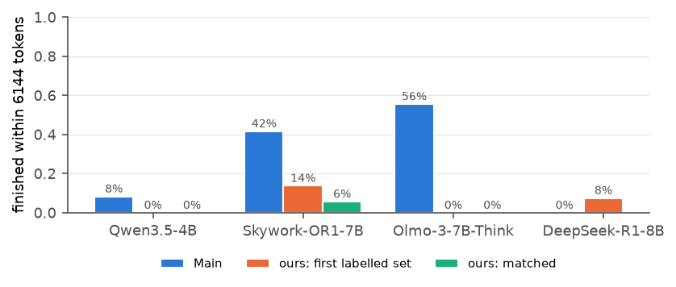
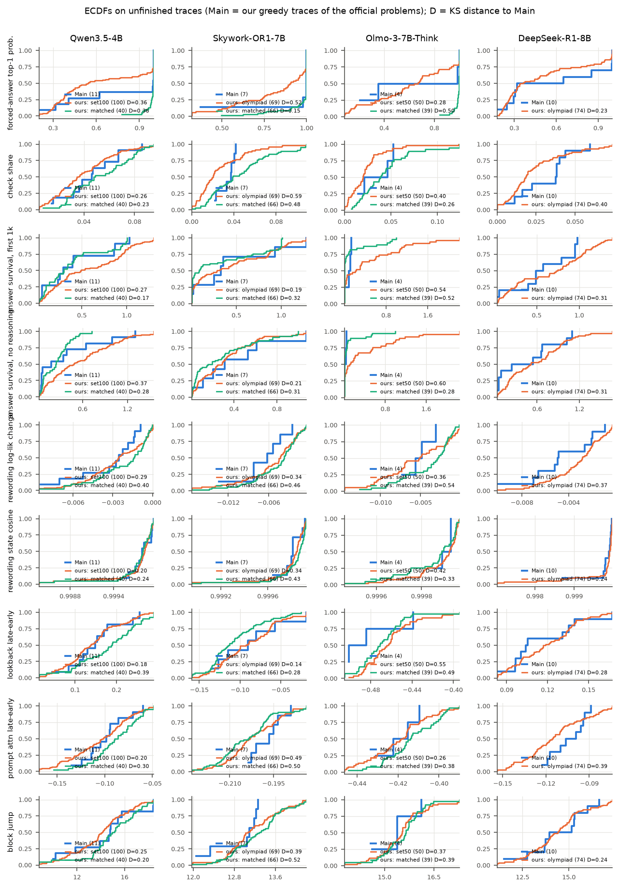

# Our own data: noise-aware evaluation and how it differs from main-v2 (for review)

Scripts:
- `analysis/report_owndata.py` (rows: `analysis/report_owndata_rows.csv`; tables: `analysis/report_owndata.csv`, `analysis/report_owndata_confident.csv`)
- `analysis/report_distfigs.py` (figures `dist_*.png`; KS table: `analysis/report_distfigs_ks.csv`)

Data: the five sets in `datasets/`, minus `olympiad_greedy_16k` (one sample per version, so no noise model applies). The label rule is `natural`
at 32k and `forced` at 6144.

**What counts as held out:**
- **In-sample:** `set100_hard_32k` (Qwen, Olmo) and `olympiad_32k` (Skywork, DeepSeek). The feature signs, per-model subsets and S2's Olmo direction were chosen on these problems' earlier labels.
- **Out-of-sample:** `confmatched_6144` and `confmatched_32k`. They were labelled after every choice was made.
- **Not replayed:** the Qwen judge.
- **Olmo router:** Olmo's Min-K% was never computed for the confidence-matched problems, so its router falls back to the novel branch there. Computing it needs Olmo on a GPU.

---

## 1. Continuous drop (no thresholding)

Partial Spearman correlation, on unfinished traces, between each variant's margin (positive = robust) and the negative accuracy drop,
holding original-problem accuracy fixed. Higher = the recipe ranks problems by how much they drop. Pooled over models, weighted by rows.

| Variant | In-sample | Out-of-sample |
|---|---|---|
| text only | 0.12 | −0.14 |
| text + output (no internals) | 0.23 | −0.09 |
| S1: text + internal (no output) | 0.23 | 0.03 |
| S2: text + internal (no output) | 0.30 | −0.03 |
| **S1** | **0.25** | **−0.09** |
| **S2** | **0.28** | **−0.16** |

## 2. Confident labels only

Each version's accuracy gets a beta-binomial posterior (uniform prior, 4000 draws). A problem is kept if P(true drop ≥ 0.25) or
P(true drop ≤ 0.10) is at least a cut-off.

**How noisy the labels are:**
- At a 0.9 cut, **only 5 of 394 problems qualify**.
- At 0.8, 16 qualify; at 0.7, 110 (28 non-robust).
- Problems we labelled robust have a median posterior probability of being truly robust of 0.60. For problems labelled non-robust it's 0.62.

So with 8 samples per version, most labels are only a little better than a coin flip. That's the clearest single measure of the noise.

Balanced accuracy at the 0.7 cut:

| Variant | In-sample (81, 13 NR) | Out-of-sample (29, 15 NR) |
|---|---|---|
| all robust | 0.50 | 0.50 |
| text only | 0.53 | 0.39 |
| no internals | 0.55 | 0.35 |
| S1 no output | 0.55 | 0.52 |
| S2 no output | 0.53 | 0.41 |
| **S1** | **0.54** | **0.35** |
| **S2** | **0.52** | **0.28** |

## 3. Within difficulty strata

Robust-vs-non-robust AUC of the margin, using only pairs whose original accuracies fall in the same bin ([0, 0.5), [0.5, 0.875),
[0.875, 1]). This removes the difficulty confound. Pooled, weighted by pairs.

| Variant | In-sample (784 pairs) | Out-of-sample (424 pairs) |
|---|---|---|
| text only | 0.45 | 0.39 |
| no internals | 0.60 | 0.55 |
| S1 no output | 0.56 | 0.51 |
| S2 no output | 0.61 | 0.48 |
| **S1** | **0.60** | **0.55** |
| **S2** | **0.62** | **0.52** |

**Per model**, from `report_owndata.csv`:
- **Skywork, `confmatched_6144`:** S1 is strongly *inverted* (AUC 0.08, partial ρ −0.49), as in exp110. Its output features (`fa`, `f1k`) point the wrong way there.
- **Olmo, `set100`:** S2 reaches 0.86. That's in-sample, since the direction was fitted on these problems.
- **Qwen:** 0.58 on `set100`, 0.67 on `confmatched_6144`.

## What this says

- **In-sample:** the recipes are modestly above chance once noise and difficulty are controlled (stratified AUC about 0.6, partial ρ about 0.25). Some of that is selection.
- **Out-of-sample:** they're at chance or below on every measure. On the 29 confidently-labelled matched problems they're clearly below chance (0.28–0.35).
- **Consistency with the report:** this matches its main claim that our labels don't transfer to the official ones. In the direction that matters (out-of-sample), our method is also not supported by our own labels.
- **White-box comparison:** no internal-vs-output difference is consistent here.
- **Recommendation:** at most one appendix paragraph, as secondary evidence that confirms Section 6. Don't use it as support for the method.

---

## Distribution differences: our data vs main-v2

### dist_1: Worst-case accuracy drop

**What it shows:**
- Main-v2's drops (all 82 rows in the file, all models) spread continuously from −0.1 to 1. The 11 rows in the 0.10–0.25 band are the ones the organisers left **unlabelled**: the official rule drops ambiguous cases rather than labelling them.
- Our sets pile up at exactly 0 and on a few discrete values, because a drop is a difference of k/8 or k/4 fractions.
- 10–28% of our problems fall in the ambiguous band, against 13% unlabelled in main-v2.
- Our non-robust shares (12–26%) bracket main-v2's 23%.

### dist_2: Finished within 6144 tokens

**What it shows:**
- Our problems almost never finish within the cap (0–14%), while main-v2's do for Skywork (42%) and Olmo (56%).
- The confidence-matched sets are unfinished by construction (they were selected that way).
- So our data covers only the unfinished regime, where every recipe acts, and none of the finished regime, which settles about a quarter of main-v2 at zero error.

### dist_3: Submission features on unfinished traces

ECDFs per model and feature: main-v2 in blue, our first labelled set in orange, confidence-matched in green. The legends give each set's KS
distance D to main-v2.

**What it shows:**
- The curves often look far apart (D 0.15–0.60). In particular:
  - our first sets have lower forced-answer confidence (`fa`) for Qwen and Skywork;
  - Skywork's check share is shifted;
  - Olmo's answer-survival features are shifted.
- But main-v2 has only 4–11 unfinished traces per model, so **only 3 of 63 comparisons are significant at p < 0.05**, about what chance gives. The figure shows where our data differs, but we can't claim it differs except in forced-answer confidence (fig. 2 in `FIGURES.md`, which uses all traces), finished share and drop shape.
- The panels use 2–98% ranges; the full values are in the per-trace files.

**Suggested use:** dist_1 and dist_2 next to Section 6 (or in the appendix), with fig. 2 from `FIGURES.md`. dist_3 is appendix-only, with
the significance caveat.
